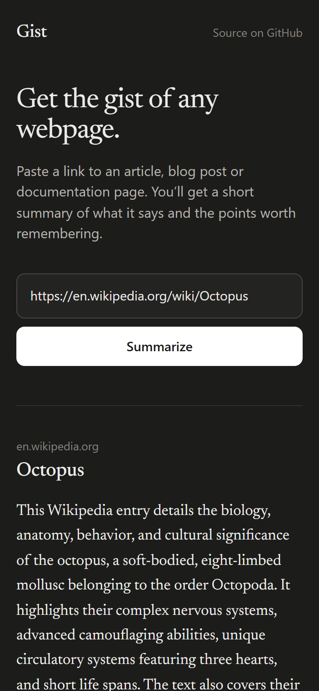

# Gist: AI web scraper & summarizer

Gist is a full-stack web app. You paste a link to a webpage and click **Summarize**. The backend scrapes the page's main text and sends it to a **free AI API** (Google Gemini by default, Groq also supported), and the frontend shows a short summary with the main points.

**Live demo:** <https://web-scrapper-dun-tau.vercel.app>

<p>
  
  &nbsp;
  
</p>

<sub>Screenshots of the live app summarizing a real Wikipedia article with Gemini, on desktop (light mode) and on a phone (dark mode).</sub>

---

## Features

- **Frontend (React + Vite):** a link field and a **Summarize** button. While the backend works, the button says **"Loading..."**, a progress line runs under the field, and a timer shows how long it's taking. The summary is laid out like a reading view: source, title, summary, main points, word count and reading time, with buttons to copy the summary or open the page. Errors appear right under the field and say what to do next. Your last five summaries are saved in the browser so you can reopen them instantly. Works on phones, supports light and dark mode, and can be used with the keyboard alone.
- **Backend (Node.js + Express):** a `POST /api/summarize` endpoint that takes the URL from the frontend.
- **Scraping (fetch + Cheerio):** downloads the HTML and removes scripts, styles, navigation, headers, footers, sidebars and hidden elements. It then pulls the text out of the main `<article>`/`<main>` area (falling back to `<body>`) in a single linear pass, so even a 6 MB page takes under a second.
- **AI integration:** sends the scraped text to **Google Gemini** (`gemini-3.5-flash-lite`) or **Groq** (`llama-3.3-70b-versatile`). Both have free tiers, and nothing uses OpenAI. The model returns JSON (`summary` + `keyPoints`), and the prompt tells it to treat page text as data, not instructions.
- **Safety & robustness:** the URL is validated, and requests to localhost and private networks are blocked (SSRF protection), including on every redirect. Requests stop after 15 s or 3 MB, follow at most 5 redirects, and anything that isn't HTML or plain text is rejected. HTML nested absurdly deep is refused, requests are rate-limited per IP, and every failure returns a readable error message.
- **Built to keep working:** if a Gemini model is rate-limited or down, the backend tries backup models and then Groq. If no AI can be reached at all, it shows the page's opening sentences, clearly labelled. Summaries are cached, and the live site is checked automatically every 6 hours (see [Reliability](#reliability)).
- **Tests:** 95 automated tests covering URL validation, SSRF bypass tricks, HTML extraction, AI reply parsing, the fallback chain, caching and full API worst cases (see [Testing](#testing)). They run on GitHub Actions on every push.

## Tech stack

| Layer      | Technology                                                    |
| ---------- | ------------------------------------------------------------- |
| Frontend   | React 19, Vite 8, plain CSS                                   |
| Backend    | Node.js (>= 20.19), Express 5, Cheerio (htmlparser2), express-rate-limit |
| AI         | Google Gemini API (free tier) or Groq API (free tier)          |
| Deployment | Vercel Services (Vite frontend + Express backend, one domain) |

## Project structure

```
web-scrapper/
├── backend/                 # Express API
│   ├── src/
│   │   ├── app.js           # Express app & routes (/api/summarize, /api/health)
│   │   ├── server.js        # Local dev server (loads backend/.env, listens on :3001)
│   │   ├── scraper.js       # URL validation, SSRF protection, fetching & text extraction
│   │   └── summarizer.js    # Gemini / Groq API calls and response parsing
│   ├── test/                # Unit + API worst-case tests (node:test)
│   ├── .env.example         # Template for your .env file  <-- copy this to backend/.env
│   └── package.json
├── frontend/                # React UI (Vite)
│   ├── src/
│   │   ├── App.jsx          # Link field, Summarize button, loading / error / summary / history
│   │   ├── api.js           # Calls the backend API
│   │   ├── main.jsx
│   │   └── styles.css
│   ├── index.html
│   ├── vite.config.js       # Proxies /api to the backend during development
│   └── package.json
├── vercel.json              # Vercel deployment: frontend + backend services, /api routing
└── package.json             # npm workspaces + scripts to run both apps
```

---

## Run it locally

### 1. Prerequisites

- **Node.js 20.19 or newer** (check with `node -v`) and npm
- A **free AI API key**. You only need one:
  - **Google Gemini (default):** sign in at <https://aistudio.google.com/apikey> and click **Create API key**.
  - **Groq (alternative):** sign up at <https://console.groq.com/keys> and create a key.

### 2. Clone and install

```bash
git clone https://github.com/whypaulwhy/web-scrapper.git
cd web-scrapper
npm install
```

`npm install` at the repo root installs the dependencies for **both** `backend/` and `frontend/` (they're npm workspaces).

### 3. Create the `.env` file (AI API key)

The `.env` file goes in the **`backend/` folder**: **`backend/.env`**. Only the backend reads it. The frontend never sees your key.

Copy the template:

```bash
# macOS / Linux / Git Bash
cp backend/.env.example backend/.env

# Windows PowerShell
Copy-Item backend/.env.example backend/.env
```

Then open `backend/.env` and paste your key:

```env
# Using Google Gemini (default)
GEMINI_API_KEY=your_gemini_api_key_here

# ...or using Groq instead
# GROQ_API_KEY=your_groq_api_key_here
```

All supported variables:

| Variable         | Required | Default                   | Description                                                        |
| ---------------- | -------- | ------------------------- | ------------------------------------------------------------------ |
| `GEMINI_API_KEY` | one of   | –                         | Google Gemini API key                                              |
| `GROQ_API_KEY`   | one of   | –                         | Groq API key                                                       |
| `AI_PROVIDER`    | no       | auto                      | `gemini` or `groq`. If unset, uses whichever key is present (Gemini first). |
| `GEMINI_MODEL`   | no       | `gemini-3.5-flash-lite`   | Gemini model to try first                                          |
| `GEMINI_FALLBACK_MODELS` | no | `gemini-3.1-flash-lite,gemini-3.6-flash` | Comma-separated Gemini models to try next if the first fails. Set it to an empty value to disable. |
| `GROQ_MODEL`     | no       | `llama-3.3-70b-versatile` | Groq model to use                                                  |
| `PORT`           | no       | `3001`                    | Port for the local backend                                         |
| `CORS_ORIGIN`    | no       | `*`                       | Allowed origin if the frontend is hosted on another domain         |
| `RATE_LIMIT_PER_MINUTE` | no | `15`                    | Summaries allowed per minute per IP address                        |
| `SUMMARY_CACHE_TTL_MS`  | no | `21600000` (6 hours)    | How long a summary is reused for the same link. `0` disables the cache. |

> `backend/.env` is listed in `.gitignore`, so it never gets committed. Don't put API keys in the frontend.
>
> **Tip:** set both `GEMINI_API_KEY` and `GROQ_API_KEY`. The app uses Gemini and only switches to Groq if every Gemini model fails.

### 4. Start the backend and frontend

**Option A: both together with one command (from the repo root):**

```bash
npm run dev
```

**Option B: in two separate terminals:**

```bash
# Terminal 1: backend API at http://localhost:3001
cd backend
npm run dev
```

```bash
# Terminal 2: frontend at http://localhost:5173
cd frontend
npm run dev
```

Then open **<http://localhost:5173>**, paste a URL (for example `https://en.wikipedia.org/wiki/Web_scraping`) and click **Summarize**.

During development the Vite dev server forwards every `/api/*` request to the backend at `http://localhost:3001` (see `frontend/vite.config.js`). If your backend runs somewhere else, start the frontend with `BACKEND_URL=http://host:port`.

### 5. Run the tests

```bash
npm test
```

### Production build (optional)

```bash
npm run build      # builds the frontend into frontend/dist
npm start          # starts the backend API only (port 3001)
```

---

## Testing

`npm test` runs 95 tests with Node's built-in test runner, in about 3 seconds. GitHub Actions runs them, plus a production build, on every push (`.github/workflows/ci.yml`). The API tests start the real Express app and mock only the outside world (DNS, websites and the Gemini API), so the whole request path is covered:

| Area | Worst cases covered |
| ---- | ------------------- |
| Bad input | missing/empty URL, arrays, objects, numbers, `javascript:`, `file:`, `ftp:`, `data:` URLs, credentials in the URL, malformed JSON, form-encoded bodies, oversized bodies |
| SSRF | `localhost`, `127.0.0.1`, decimal (`2130706433`) and hex (`0x7f.0.0.1`) IPs, `0.0.0.0`, `[::1]`, IPv4-mapped IPv6, cloud metadata (`169.254.169.254`), private ranges, public hostnames that resolve to private IPs, `.local` names, public pages that redirect to private addresses |
| Websites | redirect loops, 403/404 responses, images/PDF/JSON/video, JavaScript-only pages, empty pages, connection failures, timeouts, unknown domains, a 6 MB page (must finish in under 5 s), 50,000-level nested HTML (rejected in under 3 s), non-UTF-8 charsets, unknown charsets, broken HTML, plain text |
| AI | quota exhausted on one model (falls back to the next), on every model (labelled extract), invalid API key (stops retrying, key never leaks), retired model, Gemini down with Groq configured (switches to Groq), outage (503 HTML), timeout, safety block, empty reply, non-JSON reply, missing key |
| Cache | repeat requests reuse the summary without calling the AI; extracts are never cached; expiry and size limits |

## API reference

### `POST /api/summarize`

Request:

```json
{ "url": "https://en.wikipedia.org/wiki/Web_scraping" }
```

Successful response (`200`):

```json
{
  "url": "https://en.wikipedia.org/wiki/Web_scraping",
  "title": "Web scraping",
  "description": "",
  "summary": "Web scraping is the automated extraction of data from websites...",
  "keyPoints": ["...", "..."],
  "wordCount": 4273,
  "readingTimeMinutes": 19,
  "truncated": true,
  "provider": "Google Gemini",
  "model": "gemini-3.5-flash-lite",
  "fallback": false
}
```

`cached: true` is added when the summary was served from the cache. If no AI model could be reached, the response is still `200`, with `"fallback": true`, `"model": null`, the page's opening sentences as `summary`, and a `notice` explaining that it isn't an AI summary.

Error response (`4xx` / `5xx`):

```json
{ "error": "Could not find a website at \"example.invalid\". Check the address and try again." }
```

| Status | Meaning                                                                 |
| ------ | ----------------------------------------------------------------------- |
| 400    | Missing/invalid URL, or a URL pointing to a private/local network        |
| 415    | The URL isn't an HTML page (for example an image or PDF)                 |
| 422    | Domain not found, no readable text on the page, or HTML too deeply nested |
| 422    | The AI model refused to summarize the content                            |
| 429    | Too many requests (15/min per IP)                                        |
| 502/504| The website failed or timed out                                          |

### `GET /api/health`

Returns `{ "status": "ok", "provider": "...", "model": "...", "aiConfigured": true, "models": [...] }`. `models` lists every model the server will try, in order. Use it to check that the API key was picked up.

Quick test with curl:

```bash
curl -X POST http://localhost:3001/api/summarize -H "Content-Type: application/json" -d "{\"url\":\"https://example.com\"}"
```

---

## How it works

1. The user pastes a URL and clicks **Summarize**. The React app sends `POST /api/summarize` and shows **Loading...**.
2. The backend checks the URL (http/https only, the host must resolve to a public IP) and downloads the HTML. It follows redirects itself so it can check every hop.
3. Cheerio removes `<script>`, `<style>`, `<nav>`, `<header>`, `<footer>`, `<aside>`, forms and hidden elements. It then picks the main content container and turns block elements into clean lines of text. Pages longer than 15,000 characters get cut to that length.
4. The text goes to the AI with a prompt asking for a 2–4 sentence summary and 3–5 key points as JSON. The prompt tells the model to treat the page text as data and ignore any instructions in it. If a model fails, the next one in the chain is tried.
5. The backend sends back the summary plus some page details, and the frontend shows them as a reading view.

## Reliability

The live demo has to keep working for days without anyone watching it, so a single free-tier hiccup shouldn't break it:

| Risk | What happens |
| ---- | ------------ |
| A Gemini model hits its free quota or is overloaded | The next model in `GEMINI_FALLBACK_MODELS` is tried. Each model has its own free quota. |
| A Gemini model is retired | Same: it is skipped and the next one is used. |
| Gemini is down or the key stops working | If `GROQ_API_KEY` is set, Groq takes over. |
| No AI can be reached at all | The page's description or opening sentences are shown, with a notice saying it isn't an AI summary. The user never gets a blank error. |
| The same link is summarized again and again | The summary is reused for 6 hours, so it doesn't burn quota. |
| Something breaks anyway | `.github/workflows/live-check.yml` calls the live `/api/health` and summarizes a real page every 6 hours. If that fails, GitHub emails the repo owner. |

## Deployment (Vercel)

The live app runs on Vercel at **<https://web-scrapper-dun-tau.vercel.app>**.

`vercel.json` uses [Vercel Services](https://vercel.com/docs/services) to run both parts of the repo as one project on one domain:

- **`frontend`** service: `frontend/` is built with Vite and served as static files.
- **`backend`** service: `backend/` runs the Express app (`backend/src/app.js`) as a Vercel Function.
- Requests to `/api/*` go to the backend and everything else goes to the frontend. The frontend calls the API on the same domain, so CORS doesn't apply.

To deploy your own copy:

1. Import the GitHub repo in Vercel (or run `vercel deploy --prod` from the repo root).
2. In **Project → Settings → Environment Variables**, add `GEMINI_API_KEY` (or `GROQ_API_KEY`) for the Production environment.
3. Redeploy, then open `https://<your-app>.vercel.app/api/health`. It should show `"aiConfigured": true`.

## Limitations

- Only **static HTML** gets scraped. Pages that render their content with JavaScript (many single-page apps), pages behind a login and sites with strong bot protection may return little text or an error. The task brief asked to keep scraping simple, so this is intentional.
- Long pages get truncated to their first ~15,000 characters before summarizing.
- Free AI tiers have rate limits. If you see a quota message, wait a minute and try again.

## License

MIT
